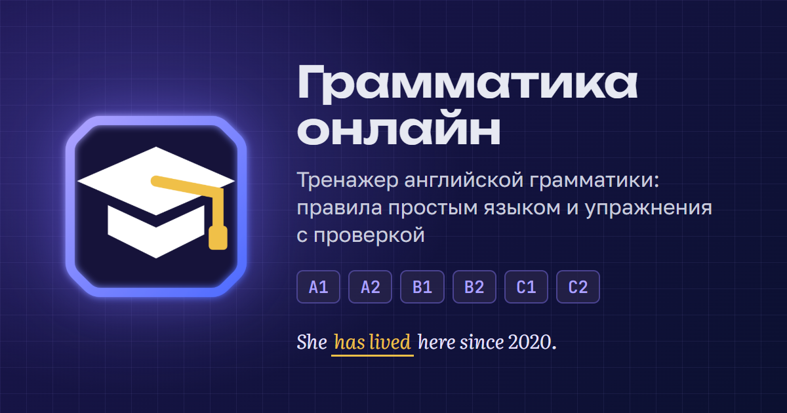

# Грамматика онлайн

Сайт: https://iltspe.github.io/grammatika-online/

## Об тренажере
Тренажер включает в себя 20 разделов и 84 темы: от базовых (артикли, времена) до сложных конструкций (Complex Object, Complex Subject, инверсия). Материал выстроен последовательно: упражнения в каждой теме используют только уже изученные правила.

Доступно 339 упражнений пяти типов:
- вставить слово в пропуск;
- выбрать правильный вариант;
- заполнить пропуски в связном тексте;
- перевести предложение;
- составить фразу по аудио.

Система проверки учитывает разные варианты ответов: принимает и сокращенные, и полные формы (например, *I'm* и *I am*, *don't* и *do not*), а также несколько корректных вариантов перевода.

Функционал платформы:
- автоматическое отслеживание и сохранение прогресса;
- экспорт и импорт прогресса на другом устройстве;
- раздел «Работа над ошибками»;
- возможность добавлять темы в «Избранное»;
- создавать свои личные заметки;
- выбор светлой / темной темы и многое другое;

Приложение работает без подключения к интернету, его можно установить на телефон или компьютер в виде приложения (подробнее «Инфо» → «Работа без интернета»).

## Данные пользователя
Прогресс, ответы, избранное, заметки и настройки сохраняются исключительно в браузере пользователя (в localStorage) и не передаются на сторонние серверы. Тренажёр не использует файлы cookie.
Статистика посещений через Яндекс Метрику начинает собираться только после того, как пользователь даст согласие в плашке о cookie. Подробнее об этом — на страницах «Как сохранить прогресс» и «Файлы cookie» в разделе «Информация» на сайте.

## О проекте и обратная связь с автором
«Грамматика онлайн» — некоммерческий и независимый проект. Об идее тренажера и о том, как связаться с автором, рассказано в начале раздела «Информация» на сайте.

## Права
© 2026, все права защищены.

Шрифты Unbounded, Golos Text, Literata и JetBrains Mono распространяются по лицензии SIL Open Font License 1.1 — ее текст лежит в `fonts/OFL.txt`.
